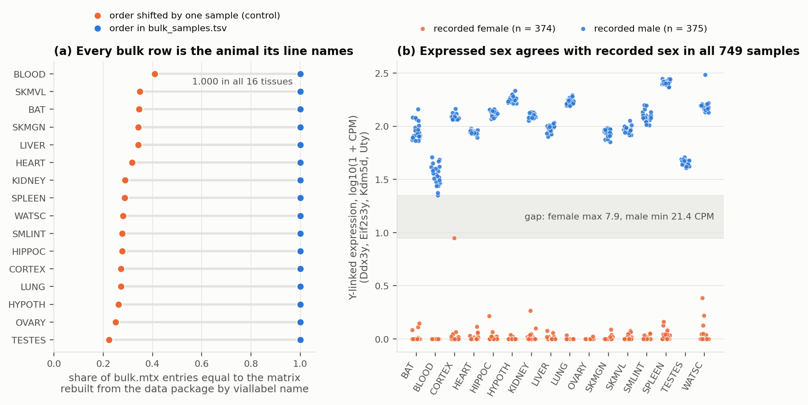
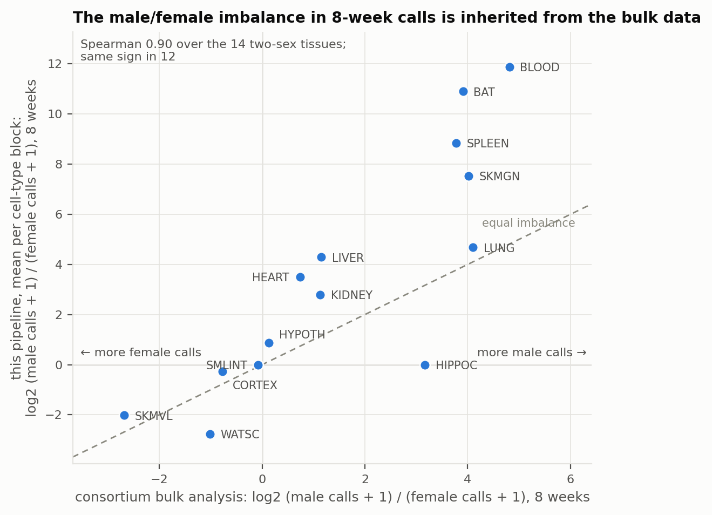

# Step 1. Integrity checks (2026-11-14)

Five audit findings pointed at places where the pipeline could be wrong without any message. A failure in any
of them would have changed every result downstream, so they were checked first. **All five came back clean or
explained. No result changed.** Guards were added so each stays checked.

| Finding | Question | Answer | Guard added |
|---|---|---|---|
| 6.9 | Is each deconvolved sample joined to the right animal? | Yes, in all 16 tissues and 749 samples | A written sample key and a checked join are registered for the rerun (`STEP3_PREREG.md` 2.5); two check scripts |
| 3.1 | Did an "April" run load the v2 weights? | The defect was real; no April run was made while it existed | Profile fixed; a mismatched pair of keys now stops the run; 15 tests |
| 6.7 | Do all weights load? | Yes: 234 of 234 tensors, v2 and April | The loader now fails on a missing tensor and records what it loaded |
| 8.4 | Why are 20 LUNG pseudo-cells missing in human space? | They are goblet-cell pseudo-cells that fall under the 200-gene floor after ortholog mapping | Documented; the test is corrected in the rerun |
| 7.2 | Why does BLOOD have thousands of male-only calls and no female-only ones? | The imbalance is in the consortium's own bulk results | None needed; reported |

Scripts: `analysis/audit_remediation/`. Record tables: `record/step1/`. Jobs 12374133 and 12374352 (4.5 and
2.3 minutes).

## 1. The sample join (finding 6.9)

**The risk.** Stage 8 renames each bulk sample `mix<i>` and drops its animal ID. Every later stage recovers
the animal as the i-th line of `bulk_samples.tsv`. If that file and the count matrix ever disagreed in order,
training labels and sex would be attached to the wrong animals and nothing would report it.

**The checks.** Each link of the chain was tested against the data, not against the code that made it.

| Link | Test | Result |
|---|---|---|
| A. Data package to `bulk.mtx` | Rebuild each tissue's matrix from the MoTrPAC package, selecting columns **by viallabel name** in the file's order, with the committed liftover map. Compare entry for entry | Equal in every entry, 16 of 16 tissues. With the order shifted by one sample (the control), 22% to 41% of entries are equal |
| B. `bulk.mtx` to fractions | One fraction row per bulk row, named `mix1..mixN` in order | 16 of 16 |
| C. `bulk.mtx` to expression (Z) | BayesPrism assigns every read of a gene to one cell type, so Z summed over cell types must give back the bulk row. For each `mix<i>`, find the nearest bulk row | The nearest row is row i for all 749 samples. Largest difference 1.2e-10 counts; shifted control 113 to 417 counts per entry |
| D. Phenotype table | `motrpac_sample_pheno.tsv` has no generator in the repository. Compare it with the package's `PHENO` | 6,156 rows, 0 differences in sex, group, intervention or sacrifice time |
| E. Sex from expression | Y-linked expression (Ddx3y, Eif2s3y, Kdm5d, Uty; chosen before any value was read) against recorded sex | Separated in all 749: lowest male 21.4 CPM, highest female 7.9 CPM |
| F. Z to pseudo-cells | Each pseudo-cell row against the Z row of its sample and type | 9,232 of 9,232 identical |
| G. Pseudo-cells to tokenized set | IDs, sample and cell-type fields, order | 9,214 rows, all consistent |
| H. Tokenized set to embeddings | One embedding per row | 9,214 |

Sex-linked expression is a standard, independent test of sample identity [toker2016]. It cannot see a swap
between two animals of the same sex; links A and C can, because they compare whole count vectors.

*Figure 1.1. (a) Share of count-matrix entries equal to the matrix rebuilt from the data package, in the file's
order (blue) and with the order shifted by one sample (orange). (b) Y-linked expression of every bulk sample by
its recorded sex; the grey band is the gap between the highest female and the lowest male. Table:
`record/step1/sample_join_summary.tsv`, `sample_join_per_sample.tsv`.*

**One observation.** A CORTEX female sample has 7.9 CPM of Y-linked reads where other females are below 1.5.
It is 14 times below the lowest CORTEX male (114.8), so the sex is not in doubt. A trace of male RNA in that
library is the likely cause. It is the single highest female value in Figure 1.1b.

**What changes.** Nothing in the results. The rerun writes the sample key at deconvolution time and every
later stage verifies it (`STEP3_PREREG.md` 2.5), so the join no longer rests on file order alone.

## 2. The April profile (finding 3.1)

**The defect.** `config/pipeline_config.yaml` pins `deconvolution.model_checkpoint` to the v2 weights, and
that key has precedence over `genecompass_model_dir`. `config/profiles/april.yaml` overrode only the second.
From 2026-11-01, when the key was added (commit `c6be8aa`), an April-profile run of Stage 9, 12 or 13 would
have embedded cells with v2's weights at April's target sum.

**Was such a run made?** No.
- No file under April's five output folders is newer than 2026-11-01.
- No SLURM script names the April profile.
- No log written since 2026-11-01 names the April profile or April's model folder.
- All 234 provenance files written since then that record a model folder record v2's.

**The fix.**
- `april.yaml` now names April's weights. `models/pytorch_model.bin` is byte-identical to
  `checkpoint-147941` (`cmp`), the checkpoint April's runs loaded.
- `deconvolution/model_checkpoint.py` refuses a checkpoint that does not sit inside the configured model
  folder, so a profile cannot change one key and keep the other model's weights.
- `tests/test_model_checkpoint.py`: 15 tests, one per profile plus the refusal cases. All pass.

## 3. The weight load (finding 6.7)

**The risk.** The scripts that embed and perturb cells rebuild the model and call
`load_state_dict(strict=False)`. The lists of missing and unexpected tensors were thrown away, so a model with
untrained tensors would have produced embeddings silently.

**The check.** The model was rebuilt as those scripts build it and the load was reported.

| Weights | Parameters | Model tensors loaded | Missing | Unexpected | Loaded but different |
|---|---|---|---|---|---|
| v2 (`rat_genecompass_finetuned_v2/.../models`) | 136,229,358 | 234 of 234 | 0 | 0 | 0 |
| April (`rat_genecompass_finetuned/.../models`) | 136,229,358 | 234 of 234 | 0 | 0 | 0 |

Record: `record/step1/weight_load.json`.

**The fix.** `finetune/genecompass/checked_load.py` loads as before and then raises if any tensor is missing,
unused, or differs from the checkpoint after loading. The embedding, perturbation and Aim-1 scripts use it.
The embedding step writes the md5 of the weights file and the load report into its provenance. The allowed
exceptions are empty, because the check found none.

## 4. Twenty LUNG pseudo-cells absent in human space (finding 8.4)

| Tissue | Cell type | Rat space | Human space | Rat only |
|---|---|---|---|---|
| LUNG | Goblet cells | 32 | 12 | 20 |

All other blocks have identical pseudo-cells in both spaces (9,214 in rat space, 9,194 in human space).

**Cause.** Both tokenizers drop a pseudo-cell with fewer than 200 expressed genes. In human space the rule is
applied after ortholog mapping, which removes 18% of the rat genes, so 20 more near-empty goblet pseudo-cells
fall under the floor (18 were already dropped in rat space). The block is far below the analysable rule in
both spaces and enters no headline.

**What changes.** The data test asserted equal counts and fails on the default, as the audit predicted (1
failed, 6 passed). In the rerun it asserts that the human cells are a subset of the rat cells, and the
transfer table lists pseudo-cells present in rat space only.

## 5. The male/female imbalance in 8-week calls (finding 7.2)

**What the audit saw.** BLOOD erythroid cells have 3,891 male-only and no female-only 8-week calls.

**What it is.** The imbalance is not particular to that block or to this pipeline.
- Every BLOOD block has 3,100 to 4,400 male calls and none female. BAT, SPLEEN, SKMGN and HEART are male-heavy
  too; SKMVL and WATSC are female-heavy.
- The consortium's own bulk differential analysis, with its technical covariates, shows the same pattern at 8
  weeks: BLOOD 2,162 male against 76 female genes, BAT 2,548 against 169, SPLEEN 821 against 59, and the
  reverse in SKMVL (74 against 480) and WATSC (188 against 380).
- Across the 14 two-sex tissues the two imbalances correlate at Spearman 0.90, with the same sign in 12.

So the per-cell-type tests inherit the sex difference of the bulk data. Sex-specific training responses are a
reported feature of this study [motrpac2024; many2024].

*Figure 1.2. Male-to-female imbalance in 8-week calls: the consortium's bulk analysis (x) against this
pipeline's mean per cell-type block (y). The dashed line marks equal imbalance. Table:
`record/step1/sex_asymmetry_ours_vs_consortium.tsv`.*

**Two things this does show.**
- The pipeline's imbalance is larger than the bulk's in the male-heavy tissues (BLOOD: about 3,800 calls per
  block against 2,162 in bulk). Each cell type's expression carries the whole tissue's change, which is also
  why one gene is called in several cell types (`STEP2_STATEMENTS.md`, finding 7.5).
- The per-sex tests of single-sex tissues are empty (TESTES and OVARY have no per-sex statistics at all).
  That is finding 7.1, repaired in the rerun.

## 6. The test suite

| Suite | Result |
|---|---|
| Offline tests | 160 passed |
| Data tests (read this machine's outputs) | 6 passed, 1 failed: the equal-count assertion of section 4 |
| New: `tests/test_model_checkpoint.py` | 15 passed |

## References

Looked up on Crossref (`record/crossref_remediation.tsv`) or already in `docs/audit/REFERENCES.md`.

- [toker2016] Toker L, Feng M, Pavlidis P. Whose sample is it anyway? Widespread misannotation of samples in
  transcriptomics studies. F1000Research 2016;5:2103. doi:10.12688/f1000research.9471.2
- [motrpac2024] MoTrPAC Study Group. Temporal dynamics of the multi-omic response to endurance exercise
  training. Nature 2024;629:174-183.
- [many2024] Many GM, et al. Sexual dimorphism and the multi-omic response to exercise training in rat
  subcutaneous white adipose tissue. Nat Metab 2024;6:963-979.
