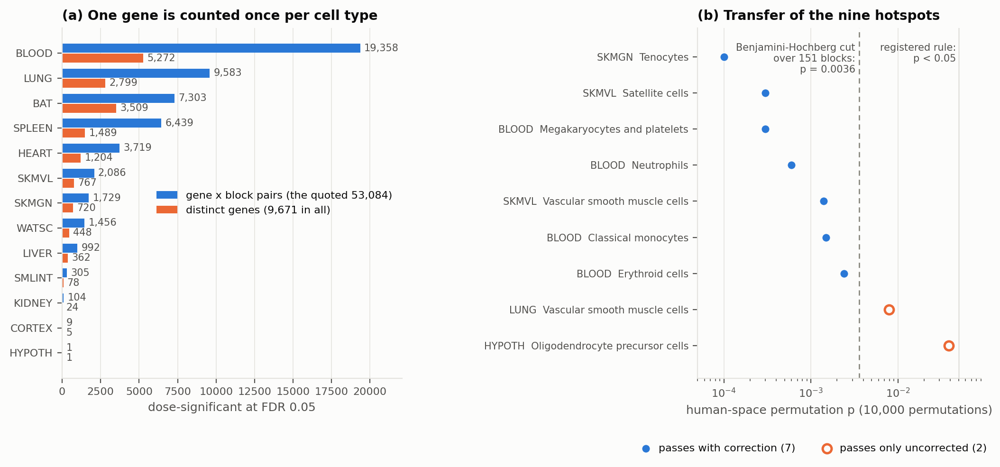

# Step 2. Statements corrected (2026-11-14)

The audit found statements in the manuscript, the tracker and the READMEs that the code or the result tables
contradict. This step corrects the ones that are wrong whatever a rerun shows. No result was recomputed; three
qualifying figures were re-derived from the default run's tables and are recorded here.

- **Changed:** the manuscript (gitignored; backup in `manuscript/_pre_audit_fix_backup_20261114/`), the tracker,
  four READMEs and results summaries, config and code comments.
- **Not changed:** dated results documents of earlier runs. They record what was reported then. The documents
  a reader starts from now carry the corrected reading and point here.
- **Numbers that the Step 3 rerun will replace** (hotspot count, DE counts, transfer counts) keep their
  current values with the qualification added; they are rewritten after the rerun.

## How to read the headline figures of the current default

| Quoted figure | What it is | Qualification |
|---|---|---|
| 53,084 dose-significant genes | Gene x block pairs at IHW FDR 0.05 over 151 blocks | **9,671 distinct genes.** A gene is usually called in several cell types of one tissue (BLOOD: 19,358 pairs, 5,272 genes, 8 blocks). 9,277 pairs are in 45 blocks whose mean fraction is below 0.01. TESTES and OVARY cannot have a call |
| 9 of 9 hotspots preserved in human space | Human AUC of at least 0.65 and a raw permutation p below 0.05 | The human test reuses the rat test's cells, labels, folds and seeds, so it is not a replication. **Under Benjamini-Hochberg over the 151 blocks, 7 of 9 pass.** The two that fail also lose their dose trend |
| Positive controls: Tier A 6 of 45 | Pre-registered controls recovered | **The registered red flag fired:** 5 of the 34 muscle and heart controls named as the pipeline-sanity subset recovered. The explanation offered was designed afterwards |
| Module A: all criteria pass | April model only | v2 passes 3 of 4. Criterion 2 is withdrawn as a test of predicted targets |
| Held-out cell-type clustering | Cells sampled from the training corpus | Nothing was held out of training |
| Rat-specific tokens' priors "are filled" | Family and network rows | 0 of 2,474 family rows and 36 of 2,474 network rows are non-zero |

*Figure 2.1. (a) Dose-significant gene x block pairs and distinct genes per tissue. (b) The nine hotspots'
human-space permutation p against the uncorrected rule (0.05) and the Benjamini-Hochberg cut over the 151
analysable blocks (0.0036). Tables: `record/step2/de_pairs_and_distinct_genes_by_tissue.tsv`,
`hotspot_transfer_with_human_bh.tsv`.*

## Re-derivations

Made by `analysis/audit_remediation/make_step2_record.py` from the default run's tables.

**Differential expression (finding 7.5).** Source: `pseudobulk_de/de_summary.tsv` and the 151 block tables.

| Tissue | Blocks | Pairs | Distinct genes | Low-fraction blocks | Pairs in them |
|---|---|---|---|---|---|
| BLOOD | 8 | 19,358 | 5,272 | 2 | 4,872 |
| LUNG | 7 | 9,583 | 2,799 | 1 | 463 |
| BAT | 6 | 7,303 | 3,509 | 0 | 0 |
| SPLEEN | 12 | 6,439 | 1,489 | 1 | 480 |
| HEART | 12 | 3,719 | 1,204 | 6 | 1,138 |
| SKMVL | 8 | 2,086 | 767 | 5 | 1,137 |
| SKMGN | 8 | 1,729 | 720 | 4 | 537 |
| WATSC | 12 | 1,456 | 448 | 4 | 224 |
| LIVER | 8 | 992 | 362 | 4 | 384 |
| SMLINT | 13 | 305 | 78 | 2 | 20 |
| KIDNEY | 11 | 104 | 24 | 3 | 19 |
| CORTEX | 10 | 9 | 5 | 3 | 2 |
| HYPOTH | 8 | 1 | 1 | 2 | 1 |
| HIPPOC, OVARY, TESTES | 28 | 0 | 0 | 8 | 0 |
| **All** | **151** | **53,084** | **9,671** | **45** | **9,277** |

**Transfer (findings 8.1, 8.2).** Source: `gate_rcv10/transfer_comparison.tsv` in the human-space folder.
q is Benjamini-Hochberg over the 151 analysable blocks; the cut falls at p = 0.0036.

| Hotspot | Rat AUC | Human AUC | Human p | Human q | Dose correlation, rat to human |
|---|---|---|---|---|---|
| SKMGN tenocytes | 0.825 | 0.925 | 0.0001 | 0.011 | 0.298 to 0.462 |
| SKMVL satellite cells | 0.887 | 0.863 | 0.0003 | 0.011 | 0.519 to 0.380 |
| BLOOD megakaryocytes and platelets | 0.837 | 0.855 | 0.0003 | 0.011 | 0.376 to 0.372 |
| BLOOD neutrophils | 0.819 | 0.830 | 0.0006 | 0.015 | 0.383 to 0.268 |
| SKMVL vascular smooth muscle cells | 0.874 | 0.811 | 0.0014 | 0.023 | 0.424 to 0.414 |
| BLOOD classical monocytes | 0.821 | 0.827 | 0.0015 | 0.023 | 0.316 to 0.310 |
| BLOOD erythroid cells | 0.828 | 0.799 | 0.0024 | 0.030 | 0.356 to 0.340 |
| LUNG vascular smooth muscle cells | 0.817 | 0.774 | 0.0079 | **0.070** | 0.284 to **-0.138** |
| HYPOTH oligodendrocyte precursor cells | 0.798 | 0.692 | 0.0384 | **0.182** | 0.112 to **-0.240** |

The two blocks that fail are the two the audit found to have no signal in gene space (all-genes AUC 0.532 and
0.499).

**Positive controls (finding 7.3).** Source: `pseudobulk_de/posctrl_results.tsv`, Tier A rows in the two
muscles and heart. The specification (`deconvolution/POSCTRL_PREREG.md`, section 4) names these as expected to
recover and calls a miss "a red flag for the deconvolution to DE pipeline".

| Tissue, cell type | Controls | Recovered | Not significant | Wrong direction | Not testable |
|---|---|---|---|---|---|
| HEART cardiomyocytes | 6 | 2 | 2 | 0 | 2 |
| SKMGN skeletal muscle cells | 14 | 2 | 9 | 0 | 3 |
| SKMVL skeletal muscle cells | 14 | 1 | 9 | 1 | 3 |
| **All** | **34** | **5** | **20** | **1** | **8** |

## The corrections

Each row gives the finding, what the text said, what it says now, and the evidence. "MS" is the manuscript.

### Model and corpus

| Finding | Was | Now | Evidence | Where |
|---|---|---|---|---|
| 2.1 | T4 tokens' family and network rows "are filled" | The 2,474 rat-specific tokens received almost no prior knowledge: 0 family rows and 36 network rows are non-zero | `logs/init_v2_11910364.err:12-13` | MS, model section |
| 3.2 | "Held-out cell-type clustering"; "held-out kNN" | Cells sampled from the training corpus; nothing was held out; labels are automated marker labels | `docs/RETRAIN_V2_PREREGISTRATION.md:13-17` | MS (3 places), tracker, `analysis/aim1_validation/*.py`, `embed_cells.py` |
| 1.2, 1.8 | "GeneCompass-exact" QC with a 15% mitochondrial cut | QC modelled on GeneCompass's with three stated departures: the 15% cut was never applied; the 3 SD rule is on total count and mitochondrial fraction, where the paper uses the number of expressed genes; mitochondrial genes are recognised by symbol, so the rule does nothing in files keyed by Ensembl ID | `preprocess_training_matrices.py:129-133,829-845`; the key `max_mito_fraction` is read by no code | MS (Results, Methods), config comment |
| 1.4 | LLM step: "Claude Haiku" | Sonnet 4.5 for 1,336 studies, Haiku 4.5 for 1,216, 3.5 Haiku for 10 | `data/catalog/llm_study_analysis.json` | MS Methods, README, config comment |
| 1.9 | Ensembl 113 / mRatBN7.2 | Ensembl 115 / GRCr8 | `config/pipeline_config.yaml:36-38` | MS (4 places) |
| 2.2 | Stage 5 "normalize_total(10,000) ... log1p"; Stage 4 CP10K "matches GeneCompass" | Raw counts divided by the hybrid median, log2(1 + x), no depth normalisation; upstream has its normalisation commented out | `tokenize_corpus.py:338-342`; `vendor/GeneCompass/preprocess/preprocess.py:157,160` | `run_stage5.py`, `compute_gene_medians.py` |
| 2.3 | "0.5M" human and mouse sets | 5,000,000 and 4,969,697 cells. The folders are named `randsel_500w_*`; "500w" is 500 wan, 5 million, so the upstream label is ten times too small | `provenance_build_mixed_species_dataset.json:55-70` | README, `stage_genecompass_assets.sh` |

### Deconvolution and references

| Finding | Was | Now | Evidence | Where |
|---|---|---|---|---|
| 4.4 | The QC gate "admits only native single-cell references, blocking spatial, engineered, developmental, or mixed data" | It blocks spatial, engineered or cultured, and bulk samples by their inventory titles; it only warns on developmental ages and mixed depth; it cannot test samples outside the inventory (BLOOD, SPLEEN, OVARY) | `deconvolution/reference_qc.py:63-77` | MS (Results, Methods) |
| 4.2 | Silent on who made the label decisions | The panels, review decisions and literature check were made by an AI assistant; no specialist has read the labels; the check's citations were read at abstract level | `JOINT_REANNOTATION_RESULTS.md:173-176`; `JOINT_REANNOTATION_LITCHECK.md:26-29` | MS Methods |
| 5.1 | Purity sweeps "confirm that the dominant parenchyma's expression is faithfully recovered" with no statement of scope | Added: each sweep mixes cells of one study, tests only the dominant type, has no registered pass rule; LIVER has none on its current reference; no hotspot cell type is tested | `deconvolution/score_purity_sweep.py:52-65`; `tissue_references.yaml` | MS |

### Gate, differential expression, transfer, perturbation

| Finding | Was | Now | Evidence | Where |
|---|---|---|---|---|
| 7.7 | DE "with a combined design sex x factor(week) ... per-sex signed z at 8 weeks combined by Fisher's method"; elsewhere "the ordinal-dose test" | The dose test is a per-sex omnibus F over factor(week), the two sexes combined by Fisher's method, corrected by IHW. The combined, ordinal and interaction models are descriptive; the 8-week z only screens sex-consistency | `run_pseudobulk_de.R:143-146,218,255-267` | MS (Results, Methods), `AIM2_DE_MOTRPAC_COMPARISON.md` |
| 7.5 | "53,084 dose-significant genes" | Gene x block pairs; 9,671 distinct genes; 9,277 pairs in low-fraction blocks | Table above | MS, tracker, three READMEs and summaries |
| 7.3 | The parenchyma result "was investigated rather than dismissed, and resolved in three ways" | The registered red flag fired (5 of 34); the three analyses were designed afterwards, lie outside the registered ladder, and account for the miss without clearing the flag | Table above; `POSCTRL_PREREG.md` section 4 | MS, tracker |
| 8.1, 8.2 | "All 9 are preserved" | All 9 meet the registered rule; 7 of 9 under Benjamini-Hochberg; the rule ignores the dose trend, which the same two blocks lose; the human test is not a replication | Table above; `translation/compare_transfer.py:64-75` | MS (3 places), tracker, READMEs, summary |
| 6.5 | Augur correlation 0.785 "just under the registered 0.80", with a tick | Reported with no verdict: no registration states a threshold | Searched every pre-registration file | `AIM2_DECONV_RESULTS.md` |
| 9.2 | Results file reads "ALL PASS" | Banner: April only; v2 fails criterion 2; the criterion is withdrawn as target validation; the myeloid replication was never scored | `data/results/retrain_v2/c5/module_a/v2/report.md:9` | `PERTURB_PREREG_RESULTS.md`, MS, tracker |
| 6.10 | "There is no Stage 11" | Stage 11 is the gate | `pipeline/run_stage11.py` | `pipeline/README.md` |
| 8.7 | Atlas Methods: "nine tissues" | Eleven atlas tissues: nine at first, serving eleven MoTrPAC tissues; spleen and ovary added under a second registration, giving thirteen | `translation/ATLAS_PROJECTION_PREREG.md:12-13`; `ATLAS_PROJECTION_16_PREREG.md:9` | MS Methods |
| - | The gate's "held-out AUC" | "Cross-validated AUC". The figure is out-of-fold, which is correct; the word is kept for data that training never saw | - | MS (6 places) |

## A wording choice

"Held-out" now means one thing in the manuscript: data the fitted object never saw. It stays for cells held out
of a reference when mixtures are simulated, and for genes held out of a mapping fit. It is removed from the
model-validation cells (in the training corpus) and from the gate's AUC (cross-validated).

## Not corrected here

- The hotspot count's sensitivity to the permutation draw (6.1), the single-sex DE defect (7.1), and the network
  difference against zero (9.1) are defects in the results. They are repaired by the rerun (`STEP3_PREREG.md`).
- The manuscript's statement that retrieval scripts are released (8.6) is made true in Step 6 by committing the
  atlas retrieval script.
