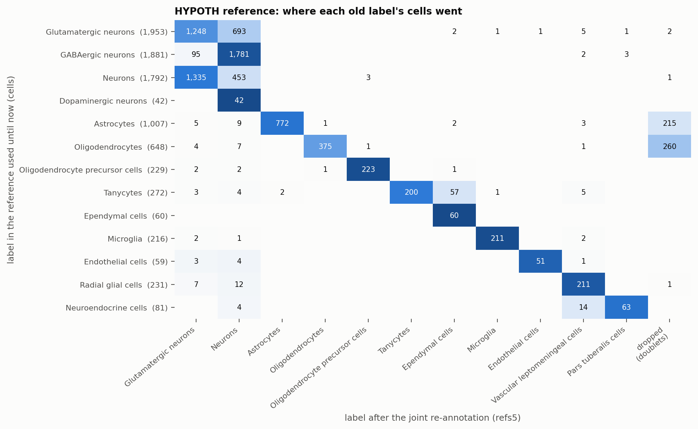
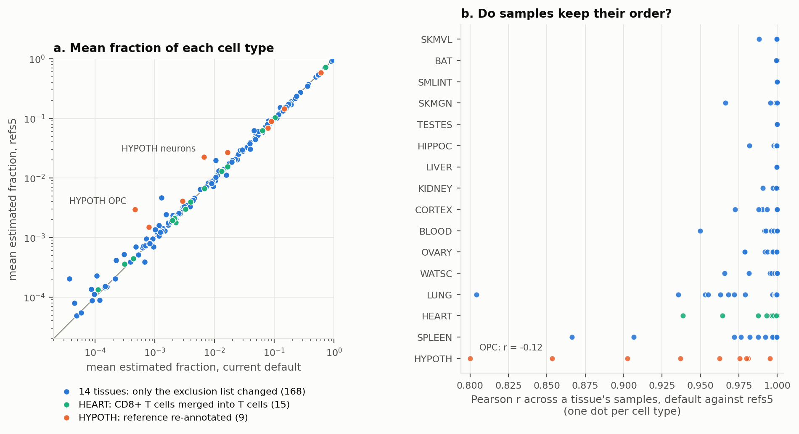

# Step 3 results: the refs5 rerun

The registered rerun of Stages 8-14 (`STEP3_PREREG.md`, with Amendment 1). This file is written as the stages
finish. Part A is complete; Part B is filled in stage by stage.

- **Part A** covers what changed before any refs5 number existed: the references, and the proof that each code
  change does what it should on the existing default's data.
- **Part B** covers the rerun itself, compared with the current default.

## Part A. Before the rerun

### A1. The references reproduce (finding 4.8)

All 15 references were rebuilt from committed code (commit `4b93b87`) into `references_v5/` and compared, file
by file, with the builds in use.

| Reference | Tissues | Cells | Types | Against the build in use |
|---|---|---|---|---|
| KIDNEY_GSE240658 | KIDNEY | 24,479 | 15 | identical |
| LIVER_GSE220075 | LIVER | 27,059 | 8 | identical |
| BLOOD_composite | BLOOD | 67,147 | 13 | identical |
| CORTEX_GSE303115 | CORTEX | 12,936 | 12 | identical |
| WATSC_GSE137869_Y | WATSC | 11,984 | 13 | identical |
| MUSCLE_GSE137869_Y | SKMGN, SKMVL | 10,740 | 9 | identical |
| BAT_GSE244451 | BAT | 28,246 | 6 | identical |
| SMLINT_GSE272055 | SMLINT | 16,193 | 13 | identical |
| LUNG_native_pooled | LUNG | 44,158 | 21 | identical |
| HIPPOC_GSE295314 | HIPPOC | 23,892 | 11 | identical |
| TESTES_OMIX767_lifted | TESTES | 5,836 | 6 | identical |
| SPLEEN_GSE306764 | SPLEEN | 13,013 | 14 | identical |
| OVARY_GSE343214 | OVARY | 9,104 | 18 | identical |
| HEART_GSE280111_LV | HEART | 135,288 | 16 to 15 | changed by design: the registered merge |
| HYPOTH_GSE248413_Y | HYPOTH | 8,471 to 7,992 | 13 to 11 | changed by design: re-annotated |

"Identical" means equal md5 of the count matrix, the gene list and the cell table. The audit's finding that no
reference had been reproduced is closed: every reference that was not meant to change comes out of the
committed code byte for byte. Record: `record/step3/references_v5_vs_refs4.tsv`.

One side effect was checked. Rebuilding BAT and HEART re-runs the step that writes the authors' labels into the
corpus annotation folder. Two of 800 annotation files (BAT samples 1 and 3) came out with a different md5, and
the BAT reference built from them is identical to the old one, so the difference is in the file's form, not
its labels.

**HEART.** "CD8+ T cells" (1,624 cells, all from one of 19 samples) is merged into "T cells" (now 7,345). The
label audit's rule had given this merge; it had not been applied.

**TESTES.** Unchanged, as registered. The control-only reference (sample C alone) was built for the
sensitivity in B2.

### A2. HYPOTH re-annotated (finding 4.1)

The one hypothalamus library was clustered by the registered joint method and labelled from the panel written
in `STEP3_PREREG.md` 2.3, before any clustering.

- 24 clusters. The rule labelled 16; 8 went to review.
- 479 cells (5.7%) in three clusters were dropped as doublets: astrocyte-neuron, oligodendrocyte-astrocyte and
  oligodendrocyte-neuron, each with both lineages' markers at intermediate level and 1.3 to 1.7 times the
  gene count of the pure cluster.
- The reference passes the reference QC gate.

| Cluster | Cells | Rule's result | Decision | Deciding genes |
|---|---|---|---|---|
| j2 | 244 | possible doublet with mural cells | Vascular leptomeningeal cells | Slc6a13, Col1a1, Bnc2, Ptgds, Dcn; the mural score is Pdgfrb, which fibroblasts share |
| j11 | 213 | tie, microglia and border-associated macrophages | Microglia | Cx3cr1 345, P2ry12 140 CPM against Mrc1 76, Cd163 30; the only myeloid cluster |
| j12 | 215 | no panel at 0.5 | dropped | Aqp4 and Snap25 together; 1,043 genes against the astrocytes' 679 |
| j13 | 84 | tie, oligodendrocytes and astrocytes | dropped | Plp1 at 37% of the oligodendrocyte level with Aqp4 387 CPM |
| j14 | 180 | tie, oligodendrocytes and neurons | dropped | Plp1 at 24% of the oligodendrocyte level with Snap25 at neuron level |
| j17 | 27 | no panel at 0.5 | Oligodendrocytes | Bcas1, Enpp6, Tcf7l2: newly formed oligodendrocytes [marques2016]; given its lineage's label so that 27 cells do not form a type |
| j21 | 190 | tie, choroid plexus and neurons | Neurons | Agrp top marker, Snap25 790; no choroid plexus gene (Ttr 4, Folr1 0 CPM): arcuate AgRP neurons [campbell2017] |
| j22 | 67 | no panel at 0.5 | Pars tuberalis cells | Cga, Tshb, Mtnr1a, Pitx1 [nakao2008] |

Every decision and its genes: `deconvolution/joint_reannotation_review.tsv`. The reviewer is the AI assistant;
these eight decisions are in the expert review plan.

**What the old labels were.**

*Figure A1. Cells of each old label (rows) by their new label (columns). Table:
`record/step3/hypoth_old_vs_new_labels.tsv`.*

- The old "Glutamatergic neurons" and generic "Neurons" were interchanged for much of the tissue: 1,335 of the
  old "Neurons" are glutamatergic by Slc17a6, and 693 of the old "Glutamatergic neurons" are not.
- The old "Radial glial cells" (231) are meningeal fibroblasts.
- The old "Neuroendocrine cells" (81) are pars tuberalis cells.
- 260 of the old "Oligodendrocytes" and 215 of the old "Astrocytes" were doublets.

**A limit of the registered rule, reported as it fell.** No neuron cluster passed the GABAergic sub-class
test. The best GABAergic score is 0.49 against the 0.5 bar (cluster j8, 720 cells, Slc32a1 330 and Gad1 336
CPM). The rule says a cluster that passes no sub-class stays at its parent, so the GABAergic clusters are
labelled "Neurons". The new reference therefore has two neuron types: "Glutamatergic neurons" (2,704 cells)
and "Neurons" (3,012), the second being GABAergic clusters plus one mixed cluster (j9, 1,587 cells) that the
clustering did not resolve. The bar was not moved after the scores were seen.

### A3. The exclusion list (finding 4.3, Amendment 1)

| | Committed list | Rebuilt list |
|---|---|---|
| Built by | no script; gene symbols on an earlier annotation | `deconvolution/build_exclude_genes.py`, from the release-115 gene table by description |
| Genes | 247 | 464 (415 ribosomal, 37 mitochondrial, 12 hemoglobin) |
| IDs that exist in release 115 | 190 | 464 |
| S6 kinases listed as ribosomal | 10 | 0 |

Under the committed list, 47 to 116 ribosomal protein genes stayed in each tissue's deconvolution, carrying
0.13% (HIPPOC) to 1.76% (BLOOD) of the counts over the deconvolved genes. The effect of the rebuilt list on
the fractions is in B1.

### A4. Each code change, checked on the existing default's data

No refs5 output is involved in this section. Each check ran the changed code on the current default's inputs
and compared with what is stored.

| Change | Check | Result | Record |
|---|---|---|---|
| Gate: permutations scored through fold kernels | Recompute the trained probe at 10 splits and 10,000 permutations for all 197 blocks | AUC, p and exceedance count identical in 197 of 197; identical to the original loop rerun on the same generator; 1,459 of 1,970,000 permutations (ties) went to the loop | `record/step3/gate_equivalence/` |
| Gate merge | Rewritten merge on the stored tables | Every old column unchanged; 151 / 158 / 197 analysable under the three library rules; the same 9 hotspots | job 12375261 |
| Transfer comparison | On the stored tables | Registered status equal in 197 rows; 9 of 9 by the registered rule, 7 of 9 corrected; dose trend lost for the same two blocks | job log |
| DE: per-sex fit for every sex present | Run all 16 tissues on the old inputs | `P_train_M`, `P_train_F`, `P_fisher` identical in the 130 two-sex blocks (1,755,187 gene rows); the 21 single-sex blocks gain a dose p | `record/step3/de_regression/` |
| Enrichment: ortholog mapping and ranking | On the stored DE tables | Old ranks reproduced in 151 of 151 blocks before the change; effect of the change below | `record/step3/enrichment_regression/` |
| DE: the gate's class copied into the DE tables, so borderline blocks are carried by name | SKMVL and OVARY on the old inputs, with a gate table that has classes | `gate_class` written for 27 of 27 blocks (3 borderline, with their AUC); dose p identical to the 16-tissue run in 23 of 23 analysed blocks; 312 offline tests pass | job 12377653 |
| Self-consistency, decoy scorer | On the stored tables | All 633 scores and the 16-tissue decoy record reproduced exactly; 0 of 633 TFs took the all-targets fallback | job log |

**What the DE repairs do, on the old inputs.** This isolates the code change from the change of references.

| | Current default | Same inputs, repaired code |
|---|---|---|
| Dose-significant gene x block pairs | 53,084 | 53,283 |
| - in the 130 two-sex blocks | 53,084 | 53,070 (52,461 in both; 623 lost, 609 gained) |
| - TESTES | 0 | 202 (58 genes) |
| - OVARY | 0 | 11 (2 genes) |
| Sex-consistent 8-week calls | 5,126 (union with repfdr on every gene-block) | 144 by concordance; 3,404 by repfdr on dose-significant gene-blocks; 3,415 union |
| repfdr density misfit (per sex) | 677.7 / 614.1 | 7.7 / 5.7 |

The 623 lost and 609 gained are the effect of treating tissue as a nominal covariate in IHW and of 21 more
blocks in the family. Fitting repfdr on training-regulated features, as the consortium does [vetr2024],
removes most of the misfit the earlier fit had.

**What the enrichment repairs do, on the old DE tables.**

| | Old | New mapping, old statistic | Registered (new mapping, dose p) |
|---|---|---|---|
| Genes in a gene set, all 151 blocks | 1,257,026 | 1,090,160 | - |
| Significant sets (padj < 0.05) | 7,502 | 6,274 | 4,761 |
| Blocks with a significant set | 132 | 127 | 101 of 130 tested |
| Tests with no p-value | 139 | 102 | 67 |

- The ortholog table uses the 13,883 pairs that Ensembl calls one-to-one. It removes 13% of the genes that were
  in gene sets. About 83% of those have no human ortholog in the map at all (mostly genes with only a mouse
  ortholog); 40 to 48 genes per block were symbol matches that named a different human gene.
- Ranking by the headline dose p in place of the sex-adjusted omnibus p removes a further 1,500 sets. OVARY had
  141 significant sets with no dose-significant gene; that cannot happen under the registered ranking.
- The gene-set table is saved with the results: md5 `ac1c1238aeffe5330e1cc1861957b956`, msigdbr 26.1.0, 1,889
  sets.

**One observation made before the rerun, stated here so it is on record.** A plumbing run of the new gate on
the current default (500 permutations per batch; its classes are not results) computed the sex-stratified
sensitivity S1. In two-sex tissues S1's p is smaller than the primary's in 133 of 173 blocks. This is expected
where the arms are sex-balanced by design: permuting within sex removes sex from the null, which is the
point of restricted permutation [winkler2014]. It means "also significant in S1", one half of the registered
reading rule for a supported hotspot, is the easier half. The rule is applied as registered.

## Part B. The rerun

Written stage by stage. Sections that have no numbers yet say so.

### B1. Stage 8: deconvolution

**The run, and its repeat.** All 16 tissues (749 samples) were deconvolved from one commit, `32bb97b`, with no
modified tracked file (jobs 12376310 to 12376325). The comparison and the target sum below come from that
run. The target sum can only be set after Stage 8, and setting it is a commit. So that every stage of the
rerun comes from one commit, which is the registered condition for refs5 to become the default, Stage 8 was
then repeated together with Stage 9 from the commit that carries the target sum, `44332e6` (jobs 12377805 to
12377820).

**The repeat reproduced the first run byte for byte.**

| File | Tissues or files | Identical md5 |
|---|---|---|
| Estimated fractions | 16 | 16 |
| Per-cell-type expression (Z) | 194 | 194 |
| The fitted BayesPrism object | 16 | 16 |
| Pseudo-cells | 16 | 16 |
| Gene list, type list, sample key, summary | 16 each | 16 each |
| Provenance records (they hold the commit and the time) | 32 | 0, as expected |

Record: `record/step3/stage8/stage8_md5_first_run_vs_rerun.tsv` and its summary. The outputs on disk are the
repeat's; every number in this section is unchanged by it.

| Check | Result |
|---|---|
| Commit recorded by each tissue | `32bb97b` in 16 of 16 (first run); `44332e6` in 16 of 16 (repeat) |
| Tissues run from a tree with uncommitted changes | 0 |
| Exclusion list | `rat_exclude_genes_v2.tsv`, md5 `61a5f0b0...`, in 16 of 16 |
| Sampler settings, read back from the fitted object | chain 1,000, burn-in 500, thinning 2, seed 123, alpha 1, in 16 of 16 |
| Sample key written beside the fractions | 16 of 16 |
| Sample-join check of Step 1, repeated on this tree | Links A to D pass in 16 of 16; lowest male Y-linked expression 21.4 CPM, highest female 7.9 |

Record: `record/step3/stage8/stage8_provenance_refs5.tsv` (first run),
`stage8_provenance_refs5_rerun_44332e6.tsv` (repeat), `sample_join_summary.tsv`, `sample_join_per_sample.tsv`.

**Genes.** Each tissue loses 58 to 122 genes to the rebuilt exclusion list and gains 8 or 9: the S6 kinases
and Mrps36 (Kgd4), which the old list had filed as ribosomal proteins. In LIVER all 74 genes that left are on
the rebuilt list.

**Fractions against the current default.**

*Figure B1. (a) Mean estimated fraction of each cell type under the current default and under refs5, for the
192 types both runs have. (b) Pearson r of a type's fraction across its tissue's samples, default against
refs5; one off-scale point is labelled. Tables: `record/step3/stage8/fractions_refs5_vs_default_by_type.tsv`,
`fractions_refs5_vs_default_by_tissue.tsv`.*

| Tissues | Types in both runs | r of 0.99 or more | r below 0.95 | Largest mean shift in a type's fraction |
|---|---|---|---|---|
| 14 where only the exclusion list changed | 168 | 144 | 5 | 2.8 points (SPLEEN B cells, 12.4% to 15.2%, r 0.999) |
| HEART (merge) | 15 | 12 | 1 | 0.18 points |
| HYPOTH (re-annotated) | 9 | 1 | 4 | 3.5 points (glutamatergic neurons, 60.6% to 58.2%) |

- **The exclusion list moves levels, not order.** In the 14 tissues, 163 of 168 types keep r of 0.95 or more.
  Four of the five below it are types under 0.1% of their tissue (BLOOD CD8+ T cells, LUNG CD4+ T cells, LUNG
  plasmacytoid dendritic cells, SPLEEN CD8+ T cells); the fifth is SPLEEN plasmacytoid dendritic cells (4.0%
  to 3.1%, r 0.87).
- **The largest level shifts are in lymphocyte-rich tissues:** SPLEEN B cells +2.8 points, SPLEEN NK cells
  -1.7, WATSC T cells +1.7, OVARY theca cells +1.2. A likely reason, not tested here, is that lymphocytes
  carry a large share of their counts on ribosomal protein genes, which is where the old list had gaps.
- **HEART.** "T cells" is 1.55% against 1.65% + 0.01% for the two old types. No other type moves by more than
  0.2 points.
- **HYPOTH.** The types are not the same types as before, so this row compares labels more than estimates.
  "Vascular leptomeningeal cells" take 5.6% of the tissue, where the old "Radial glial cells" took 5.0%:
  the same cells under their corrected name (A2). "Neurons" (GABAergic and unresolved clusters) take 2.3%
  and "Glutamatergic neurons" 58.2%; under the old labels the split was 0.7% "Neurons", 0.5% "GABAergic
  neurons" and 60.6% "Glutamatergic neurons". The estimate still puts almost all neuronal signal in one
  type. That is a limit of this reference and is listed in the review plan.

**One HYPOTH sample stands apart, under both runs.** Viallabel 90406015402 (female, 4-week trained) is the
sample with the largest change in every HYPOTH comparison. Under refs5 it is given 13.4% oligodendrocyte
precursor cells (the other 49 samples: at most 0.13%) and 16% "Neurons". Under the default it was given 24%
"GABAergic neurons" and 32% "Neurons", against tissue means of 0.5% and 0.7%.

| Cell type | r, all 50 samples | r, without that sample |
|---|---|---|
| Glutamatergic neurons | 0.902 | 0.996 |
| Oligodendrocyte precursor cells | -0.115 | 0.879 |
| Microglia | 0.853 | 0.898 |
| Neurons (a different set of cells in the two references) | 0.937 | 0.008 |

Record: `record/step3/stage8/hypoth_r_with_and_without_one_sample.tsv`. The sample is kept: the registration
has no rule for removing a sample, and none is made now. Its composition looks like a different piece of
tissue (a dissection that reached a neighbouring region is one explanation; this was not tested). HYPOTH
oligodendrocyte precursor cells were a hotspot in the current default, so this block is read with that sample
in mind in B4, and the sample is named in the review plan.

### B2. TESTES against a control-only reference (sensitivity, 2.2)

The primary reference pools the control animal and the animal seven weeks after EDS (5,836 cells). The
sensitivity reference is the control animal alone (2,150 cells). Both keep all six cell types; in the
control-only reference "Sertoli cells" has 21 cells, one above the 20-cell rule.

| Cell type | Mean fraction, primary | Mean fraction, control-only | Mean absolute difference | r over the 25 samples |
|---|---|---|---|---|
| Sertoli cells | 37.2% | 31.6% | 5.6 points | 0.998 |
| Spermatocytes | 23.6% | 28.3% | 4.7 points | 0.997 |
| Condensed spermatids | 11.6% | 15.9% | 4.3 points | 0.994 |
| Spermatogonia | 6.0% | 2.3% | 3.8 points | 0.993 |
| Round spermatids | 6.1% | 7.8% | 1.7 points | 0.988 |
| Elongating spermatids | 15.5% | 14.2% | 1.3 points | 0.996 |

- **Order across animals is the same** under either reference (r of 0.988 or more for every type), so
  anything that compares animals (the differential framing the project uses) does not depend on this choice.
- **Levels depend on it** by up to 5.6 points. Neither set of levels is validated; the known Sertoli-cell
  overestimate is smaller under the control-only reference and does not go away.
- The deconvolution uses 13,878 genes with the control-only reference against 13,633 (263 enter, 18 leave),
  because the gene filter depends on the cells present.

Record: `record/step3/stage8/testes_controlonly_vs_primary_by_type.tsv` (job 12376328, same commit). The
primary stays the pooled reference, as registered. The choice is the PI's and the collaborator's.

### B3. Stage 9: the target sum, tokenization and embedding

The registered formula (`RETRAIN_V2_PREREGISTRATION.md`, lines 155-164; `STEP3_PREREG.md` 3) fixes one target
sum for every tissue from the LIVER pseudo-cells.

| Quantity | Value |
|---|---|
| refs5 LIVER pseudo-cells | 400 |
| Their median non-zero value, tokenized at 6,400 | 0.87944 |
| Median non-zero value of the v2 training corpus | 0.91453 |
| Formula result | 6,745.2 |
| **Target sum (nearest 100)** | **6,700** |
| Predicted LIVER median at 6,700 | 0.90999 |

The registration's estimate on the old LIVER pseudo-cells was "about 6,800". The value is the formula's on
the refs5 pseudo-cells; it was set in `config/profiles/refs5.yaml` before any tissue was tokenized for
analysis. Record: `record/step3/stage8/target_sum.json` (job 12376341).

**Stage 9 ran for all 16 tissues from `44332e6`, clean tree.** LIVER's median at 6,700 is 0.9100, the
formula's prediction.

| Tissue | Pseudo-cells embedded | Dropped (fewer than 200 genes) | Genes eligible for a token | Median non-zero value |
|---|---|---|---|---|
| BAT | 300 | 0 | 14,102 | 0.868 |
| BLOOD | 650 | 0 | 14,811 | 0.878 |
| CORTEX | 600 | 0 | 15,306 | 1.027 |
| HEART | 750 | 0 | 15,765 | 0.919 |
| HIPPOC | 550 | 0 | 15,243 | 1.056 |
| HYPOTH | 550 | 0 | 13,985 | 0.990 |
| KIDNEY | 750 | 0 | 14,833 | 1.022 |
| LIVER | 400 | 0 | 12,701 | 0.910 |
| LUNG | 1,028 | 22 | 15,158 | 1.131 |
| OVARY | 432 | 0 | 14,095 | 0.996 |
| SKMGN | 450 | 0 | 13,093 | 0.898 |
| SKMVL | 450 | 0 | 13,092 | 0.916 |
| SMLINT | 650 | 0 | 12,790 | 0.884 |
| SPLEEN | 700 | 0 | 13,065 | 0.977 |
| TESTES | 150 | 0 | 13,623 | 1.130 |
| WATSC | 650 | 0 | 12,781 | 0.938 |
| **All** | **9,060** | **22** | | |

- **The model weights loaded completely in every tissue:** 234 of 234 tensors, none missing, none unexpected,
  none differing after the load. This is the guard added in Step 1 (finding 6.7), now recorded in each
  tissue's embedding provenance.
- **22 LUNG pseudo-cells are dropped at tokenization** because they express fewer than 200 eligible genes (the
  current default dropped 18). All 22 are goblet-cell pseudo-cells, so LUNG goblet cells enter the gate with
  28 of 50 samples. No other tissue loses a pseudo-cell.
- **One target sum for 16 tissues is a compromise, as registered.** It puts LIVER on the training corpus's
  median (0.9145); other tissues sit between 0.868 (BAT) and 1.131 (LUNG).

Record: `record/step3/stage9/stage9_by_tissue_refs5.tsv`.

### B4 to B7. Gate, differential expression, transfer, networks

*(filled in as stages finish)*
