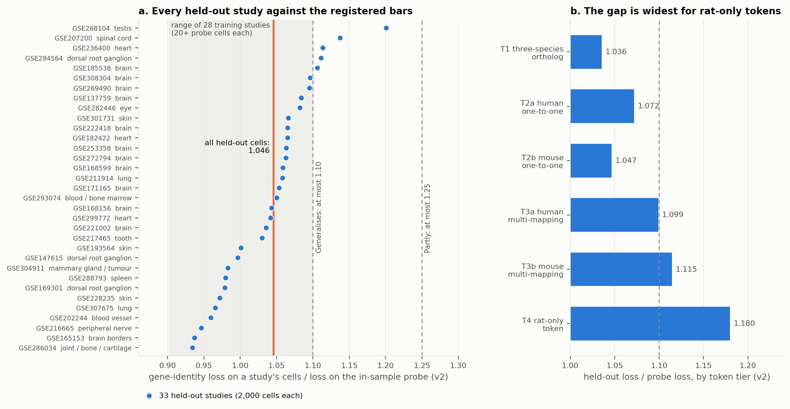

# Step 4 results: the validations the audit found missing

Each check below was registered in `STEP4_PREREG.md` before the refs5 rerun produced a number. Sections are
filled in as their jobs finish.

| | Check | Registered reading | Result |
|---|---|---|---|
| V1 | Expression accuracy by purity sweep, dominant and hotspot cell types | Median correlation of at least 0.95 at every purity of 0.5 and above | *(running)* |
| V2 | Positive controls on refs5 | Red flag stands if fewer than half of the testable sanity controls recover | *(after Stage 10)* |
| V3 | Held-out test of the model | Held-out loss at most 1.10 times the in-sample loss | **Generalises: 1.046** |
| V4 | Module A on the current model and references | Criteria 1, 3 and 4; myeloid replication reported, not a gate | **1, 3 and 4 pass. Replication fails:** Spi1 at the 81st percentile; Cebpa not testable |
| V5 | mRNA-content bias with a bias-free baseline | Per-reference RMSE differences | *(running)* |
| V6 | Mixture panel on refs5 | The registered floor | *(running)* |

## V3. A held-out test of the model (findings 3.2, 3.6)

**Result.** On rat cells from 33 studies the model never saw, v2's gene-identity loss is 1.046 times its loss
on the in-sample probe. The registered bar for "Generalises" is 1.10.

| Model | Cells | Studies | Gene-identity loss | Value loss | Top-1 accuracy |
|---|---|---|---|---|---|
| v2, in-sample probe | 2,000 | 77 | 3.0590 | 2.48e-4 | 25.5% |
| **v2, held-out** | **66,000** | **33** | **3.1991** | 3.75e-4 | 23.5% |
| April, in-sample probe | 2,000 | 77 | 5.3102 | 3.92e-4 | 18.8% |
| April, held-out | 66,000 | 33 | 5.3999 | 5.65e-4 | 17.7% |

| Registered quantity | Value | Reading |
|---|---|---|
| v2 held-out loss / v2 probe loss | **1.0458** | **Generalises** (at most 1.10) |
| The same for April (context; April saw none of these cells either) | 1.0169 | - |

Both models scored the same held-out cells under the same masks (13,805,095 masked tokens). The evaluator's
recorded probe losses were reproduced digit for digit before any held-out cell was scored
(`record/step4_heldout/probe_reproduction.tsv`).

*Figure V3. (a) Each held-out study's loss over the pooled in-sample probe loss; the shaded band is the range
of the 28 training studies with at least 20 probe cells. (b) The same ratio by token tier. Tables:
`record/step4_heldout/losses_by_study.tsv`, `losses_by_tier.tsv`, `registered_reading.tsv`.*

### Reported with it, as registered

- **Per study.** The ratio runs from 0.93 to 1.20, median 1.05. 28 of 33 studies are at or under 1.10; five
  are between 1.10 and 1.25 (testis 1.20, spinal cord 1.14, embryonic heart 1.11, dorsal root ganglion 1.11,
  cortex and hippocampus 1.11); none is above 1.25. Training studies themselves span 0.90 to 1.10.
- **Per tier.** The gap grows as tokens lose their cross-species anchor: 1.04 for three-species orthologs,
  1.07 and 1.05 for one-to-one human and mouse orthologs, 1.10 and 1.12 for multi-mapping ones, and **1.18
  for rat-only tokens**. Rat-only tokens are learned from rat data alone, and that is where the model
  transfers least well to a new study.
- **Value loss.** 1.51 times the probe's. No bar was registered for it. It is largest in cells with fewer
  than 500 expressed genes (`losses_by_length.tsv`).
- **Per tissue.** Lowest loss in joint and cartilage (2.86), highest in testis (3.67)
  (`losses_by_tissue.tsv`).

### How the held-out set was built

| Step | Series |
|---|---|
| Returned by both GEO queries and so lost to the corpus (finding 1.1) | 108 |
| Confirmed rat single-cell by the LLM step | 79 |
| With a usable MTX, H5 or h5ad matrix (the registered candidates) | 35 |
| Removed by the registered exclusions | 1 |
| With cells after QC and the file rules | **33** |

- **The registered exclusion removed one series.** GSE304998 is the SuperSeries of training series GSE284698
  and shares 41 of its 71 samples with it. 1,120 training-side sample accessions were compared.
- **Cell QC** is Stage 2's, unchanged, into a folder of its own: 257 files, 4,303,867 cells passing.
- **File rules.** The registration fixed series-level exclusions only. Reading the files showed that was not
  enough, so the corpus plan's own file rules were applied, with two safeguards, before any cell was
  tokenized:

| Action | Files | Cells | Why |
|---|---|---|---|
| Kept | 220 | 3,299,571 | 33 series, 21 tissue groups |
| Dropped: not rat | 10 | 53,857 | 4 human-donor files (by GEO organism); 6 mouse-annotated files with no sample accession (by feature names) |
| Dropped: not raw counts | 13 | 163,916 | Matrices Stage 2 had "reverse-normalised", including pseudo-bulk group tables |
| Dropped: duplicate | 14 | 786,523 | 11 are GSE263307, a second deposit of 11 of GSE171165's libraries under new accessions (99.8% shared barcodes) |

- **The draw.** 2,000 cells from each of the 33 studies, fixed seed: 66,000 cells.
- **Unseen at the level of the cell, not only the accession.** None of the 66,000 token sequences equals any
  of the 6,803,206 training cells, and the largest barcode overlap of a kept file with a training file is
  7.8% (`unseen_check.tsv`, `unseen_barcode_check.tsv`).

### The order of steps

The evaluated cells were fixed before any loss on them existed. The evaluation set was written at 13:21 and
the first evaluation job started at 13:47; both evaluation jobs print the set's checksums at start, and they
equal the files on disk. One preparation job ran again at 14:07, while the v2 evaluation was running, to add
two descriptive columns to the file table. Its log prints the same counts per action as the first run, and
the set itself was not rewritten. No file rule was added or changed after a held-out loss was seen.

### Departures from the registration, and limits

- **The evaluator could not score a rat-only set** (it divides by the number of masked human tokens), and it
  has no per-study output. A wrapper calls its own masking and model-loading functions and reproduces its
  recorded numbers exactly; a test shows both facts.
- **File rules were not registered** (above). They were fixed from file metadata, not from any loss, and they
  removed 1,004,296 of the 4,303,867 QC-passing cells.
- **One sibling series is kept.** GSE304911 shares a SuperSeries with a training series but no sample; the
  registered rule does not remove it. Without it the ratio is 1.048.
- **The two sets are weighted differently.** The probe is weighted by cell over 77 studies; the held-out set
  takes 2,000 cells from each study. Held-out cells are also longer (mean 1,395 expressed genes against
  1,059). Within bins of length the held-out excess is 0.3% to 4.7%.
- **Not registered, for context:** resampling the 33 studies gives a 95% interval of 1.026 to 1.065 for the
  ratio; leaving any one study out gives 1.042 to 1.049.
- **What the test is.** Generalisation to a new rat study that came through the same harvest and the same QC,
  on the masked-token task the model was trained on. It is not a test on a new kind of data, and it says
  nothing about the pseudo-cells of Stages 9 to 13, which are not single cells. Held-out cells have no labels,
  so the clustering checks were not repeated.
- **243 of the 66,000 cells are Visium spots** (GSE299772), kept because the corpus's own rules keep such
  files. Without them the ratio is 1.046.

Scripts: `analysis/audit_remediation/heldout/`. Tests: `tests/test_heldout.py`. Record:
`record/step4_heldout/`. Jobs: 12375158-60 (QC), 12376266 (probe), 12377246 and 12378063 (file plan, tokenize,
draw), 12377965 (v2), 12377966 (April).

## V4. Module A on the current model and references (finding 9.2)

**What ran.** The v2 model, the refs5 pseudo-cells, the perturbation engine unchanged (job 12378166).
- **Muscle:** the frozen 80-gene panel plus Alb and Snap25, deleted one gene at a time in the 50 SKMVL
  "Skeletal muscle cells" pseudo-cells.
- **Monocytes:** the replication the 2026-07-03 registration named and nobody had scored. Its rules were
  written on 2026-11-14 before any perturbation ran (addendum to V4): every gene within 15% of the factor's
  mean value in the 50 BLOOD "Classical monocytes" pseudo-cells is its null.

*Figure V4. Share of expression-matched genes whose deletion moves the cell embedding less than the factor's
does. (a) Mef2c in skeletal muscle cells. (b) Spi1 in classical monocytes. The dashed line is the registered
90th percentile. Tables: `record/step4/v4_module_a/muscle/panel_shifts_with_roles.tsv`,
`record/step4/v4_module_a/monocytes/myeloid_panel_shifts.tsv`.*

### The registered criteria, in muscle

| # | Criterion | refs5, v2 | v2 on the July references (2026-10-24) | April on the July references |
|---|---|---|---|---|
| 1 | Mef2c's shift above the 90th percentile of its matched null | **100th of 26 genes: pass** | 100th of 26 | 96th of 27 |
| 3 | Alb and Snap25 in no cell, or below the null median | **in 0 cells each: pass** | pass | pass |
| 4 | Shift rises with expression (Spearman above 0) | **0.77: pass** | 0.76 | 0.74 |
| 2 | Mef2c's top 25 targets in the muscle set | withdrawn; 0 of 25, printed for the record | 0 of 25 | 4 of 25 |

- **Criteria 1, 3 and 4 pass on the current model and references**, with numbers close to the earlier v2 run.
  The audit's point was that they had never been scored on them.
- **Criterion 2 carries no verdict** (PI decision 4). The overlap is 0 of 25, as it was for v2 before.
- **How well the frozen panel still matches.** The panel was matched to Mef2c on the July pseudo-cells. On
  refs5, Mef2c's mean value is 1.65, the 16th highest of the 77 panel genes that are in the cells, and 26
  panel genes fall within 15% of it (1.40 to 1.86). Three panel genes are in no muscle pseudo-cell.

### The myeloid replication

| Factor | In the cells | Matched null | Shift | Percentile | Reading |
|---|---|---|---|---|---|
| Spi1 | 50 of 50 pseudo-cells, mean value 1.43 | 232 genes | 2.3e-6 (null median 1.3e-6, 90th percentile 4.4e-6) | 81st | **does not replicate** |
| Cebpa | token in no classical-monocyte pseudo-cell | - | - | - | **not testable** (coverage, step 1 of the registered ladder) |

- **The replication fails.** The one testable factor, Spi1, moves the monocyte embedding more than 81% of
  equally expressed genes. The registered bar is 90%.
- **It was registered as a replication, not a gate,** so Module A's verdict on criteria 1, 3 and 4 stands as
  scored. What the failure does say: the muscle result for Mef2c is one factor in one cell type, and the
  second lineage chosen in advance to guard against "a muscle-only artifact" does not show it.
- **Why Cebpa is absent.** Its token is not among the top 2,048 genes of any classical-monocyte pseudo-cell.
  That is a limit of the input (the deconvolved expression of a low-expressed gene), not a test of the model.
- **Printed without a verdict:** over the 233 perturbed genes the shift rises with expression, Spearman 0.22
  (0.77 in muscle).

### What this does and does not show

- The shifts are of order 1e-6 in cosine distance. Criterion 1 is a ranking among about 26 genes, on 50
  pseudo-cells that are 50 animals' estimates of one cell type, not 50 cells.
- A null of 26 genes makes the 90th percentile coarse: Mef2c had to beat 24 of them.
- Deleting a gene moves every lower-ranked gene up one position, and the model uses position embeddings, so a
  shift holds both effects. No control separates them (finding 9.6).
- With the network results (the decoy null finds no factor-specific signal), Module A supports this much:
  the engine runs, behaves sensibly on not-expressed genes, and ranks one muscle factor above its matched
  genes. It does not establish that the model's perturbation responses identify a factor's targets.

Record: `record/step4/v4_module_a/` (`muscle/report.md`, `report.json`, `results.tsv`;
`monocytes/myeloid_replication.tsv`, `panel.tsv`).

## V1, V2, V5, V6

*(filled in as they finish)*
