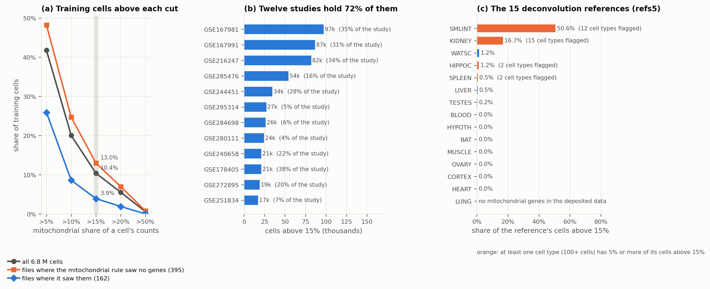
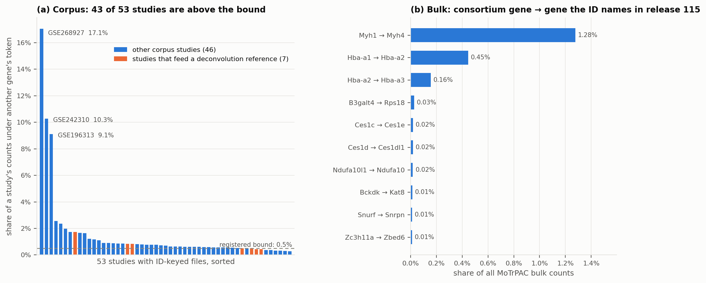

# Step 5 results: corpus and model findings, measured

The PI's decision is no retrain. These findings therefore cannot be repaired in the model. Each was measured
against a reading rule written first (`STEP5_PREREG.md`), and each is disclosed with its number.

| | Finding | Result | Registered reading |
|---|---|---|---|
| M1 | No mitochondrial cut on training cells | 10.4% of the 6.8 million training cells are above 15% | **Material departure** (the rule's top band, above 5%) |
| M1 | The same in the deconvolution references | SMLINT 50.6% and KIDNEY 16.7% of reference cells above 15%; every cell type of both is flagged. HIPPOC and SPLEEN have two flagged types each. LUNG cannot be measured | **To the expert review plan**; references not rebuilt in this pass |
| M2 | 79 single-cell series never entered the corpus | *(filled in when the held-out set is built)* | Used as the held-out set of Step 4 |
| M3 | Gene IDs carried over from earlier annotations | 1.04% of counts in ID-keyed corpus files sit under another gene's token; 43 of 53 studies are above the 0.5% bound. In the bulk, 2.24% of counts | **Not negligible.** Studies and genes listed; four reference studies above the bound go to the review plan |
| M4 | Genes that cannot be tokenized | At most 0.01% of a tissue's pseudo-cell counts (TESTES); zero in 12 of 16 tissues | Reported per tissue; no threshold |

## M1. Mitochondrial fraction (findings 1.2, 1.3)

**What was measured.** For every QC file the v2 corpus keeps (584 files, 6,803,206 cells): each cell's share
of counts on the 13 mitochondrial protein-coding genes, found by Ensembl ID
(`analysis/audit_remediation/measure_mito_fraction.py`).

*Figure 5.1. (a) Share of training cells above each cut, for all cells and for the files where the
mitochondrial outlier rule did and did not see mitochondrial genes. (b) The twelve studies with the most
cells above 15%. (c) Share of each refs5 reference's cells above 15%, read from the reference's own count
matrix. Tables: `record/step5/mito_overall.tsv`, `mito_by_study.tsv`, `mito_by_file.tsv`,
`mito_by_reference.tsv`, `mito_by_reference_refs5_direct.tsv`.*

### Training cells

| Cut | Cells above it | Share of 6,803,206 |
|---|---|---|
| 5% | 2,842,801 | 41.8% |
| 10% | 1,365,203 | 20.1% |
| **15% (GeneCompass's cut [yang2024])** | **708,763** | **10.4%** |
| 20% | 378,918 | 5.6% |
| 50% | 42,201 | 0.6% |

- **The reading is the rule's top band: a material departure from GeneCompass's QC.** A future corpus should
  apply a cut. The studies concerned are in `record/step5/mito_by_study.tsv`.
- **The outlier rule was inert in 395 of 584 files** (4,889,822 cells): the stored mitochondrial percentage is
  zero for every cell, because the rule looked for genes by symbol in files keyed by ID. In those files 13.0%
  of cells are above 15%; in the files where the rule saw the genes, 3.8%.
- **It is concentrated.** Five studies hold half of the cells above 15% and twelve hold 72%. Thirty-seven of 81
  studies have more than 5% of their cells above 15%; thirteen have none.
- **Twelve files cannot be measured.** They hold no mitochondrial counts at all (154,614 cells in six studies,
  2.3% of the corpus), so their cells count as below every cut. The deposited matrices had the genes removed.
  10.4% is therefore a floor.

| Study | Cells | Above 15% | Share of the study |
|---|---|---|---|
| GSE167981 | 274,591 | 97,079 | 35% |
| GSE167991 | 278,522 | 86,590 | 31% |
| GSE216247 | 243,198 | 81,953 | 34% |
| GSE285476 | 337,912 | 54,067 | 16% |
| GSE244451 (the BAT reference study) | 123,890 | 34,484 | 28% |

**What this does and does not show.** A fixed cut is tissue-dependent: cardiomyocytes, hepatocytes and kidney
tubule cells carry more mitochondrial RNA than leukocytes, and a 15% cut removes healthy cells in such tissues
[osorio2021; luecken2019]. So 10.4% is the size of the departure from the GeneCompass recipe, not a count of
damaged cells. What the model learned from these cells was not measured and cannot be without a retrain.

### Reference cells

The registered rule flags a reference when 5% or more of some cell type's cells (types with at least 100 cells)
are above 15%.

| Reference | Cells | Above 15% | Cell types with 100 cells or more | Flagged |
|---|---|---|---|---|
| **SMLINT_GSE272055** | 16,193 | **50.6%** | 12 | **12** |
| **KIDNEY_GSE240658** | 24,479 | **16.7%** | 15 | **15** |
| HIPPOC_GSE295314 | 23,892 | 1.2% | 10 | 2 (astrocytes 6.6%, endothelial cells 5.3%) |
| WATSC_GSE137869_Y | 11,984 | 1.2% | 9 | 0 |
| LIVER_GSE220075 | 27,059 | 0.5% | 6 | 0 |
| TESTES_OMIX767_lifted | 5,836 | 0.2% | 5 | 0 |
| BAT, CORTEX, HEART, HYPOTH, MUSCLE | | 0.0% | | 0 |
| LUNG_native_pooled | 44,158 | **not measurable**: its three source files hold no mitochondrial counts | | - |
| BLOOD (composite), OVARY, SPLEEN | | not covered by this measurement | | see below |

- **SMLINT.** Enterocytes, the dominant type (7,361 cells), have a median mitochondrial share of 20%; 72% are
  above 15% and 13% above 50%. Every type is flagged, from goblet cells (65%) to erythroid cells (8%).
- **KIDNEY.** Proximal tubule cells, the dominant type (12,149 cells), are the least affected (8.0% above
  15%). The other 14 types run from 11% to 39%.
- **As registered, neither reference is rebuilt in this pass.** A mitochondrial cut on a reference is a new
  analysis choice. Intestinal epithelium and kidney tubule are tissues where a high mitochondrial share can be
  biology and where a low cut removes real cells [osorio2021]. Which it is here needs someone who knows the
  tissue, so both references go into the expert review plan with these tables.
- **Why it matters for results.** A reference profile averaged over damaged cells is a wrong profile.
  Mitochondrial genes are excluded from the deconvolution, so the concern is the rest of a damaged cell's
  profile. Neither SMLINT nor KIDNEY holds a hotspot in the current default; whether either does in refs5 is
  read in `STEP3_RESULTS.md`.

**All 15 refs5 references, measured directly.** The table above matched reference cells to corpus QC files,
so it could not cover the three references built outside those files, and it was run on the references in use
before refs5. A second measurement reads each refs5 reference's own count matrix
(`analysis/audit_remediation/measure_mito_reference_direct.py`).

| Reference | Cells | Above 15% | Flagged cell types |
|---|---|---|---|
| SMLINT_GSE272055 | 16,193 | 50.6% | 12 of 12 |
| KIDNEY_GSE240658 | 24,479 | 16.7% | 15 of 15 |
| WATSC_GSE137869_Y | 11,984 | 1.2% | 0 |
| HIPPOC_GSE295314 | 23,892 | 1.2% | 2 (astrocytes 6.6%, endothelial cells 5.3%) |
| **SPLEEN_GSE306764** | 13,013 | 0.5% | **2** (plasma cells 5.2% of 191; red-pulp macrophages 5.0% of 100) |
| LIVER_GSE220075 | 27,059 | 0.5% | 0 |
| TESTES_OMIX767_lifted | 5,836 | 0.2% | 0 |
| **BLOOD_composite** | 67,147 | 0.04% | 0 |
| **OVARY_GSE343214** | 9,104 | 0.0% | 0 |
| HYPOTH_GSE248413_Y (re-annotated) | 7,992 | 0.01% | 0 |
| BAT, CORTEX, HEART, MUSCLE | | 0.0% | 0 |
| LUNG_native_pooled | 44,158 | not measurable (0 of 13 mitochondrial genes in the matrix) | - |

- **The two measurements agree.** For the 138 cell types both cover, the share above 15% agrees to within
  0.01 points in every reference except TESTES, whose lifted matrix holds fewer genes (spermatogonia 1.8%
  against 0.6%).
- **New from this measurement:** BLOOD and OVARY are clean. SPLEEN has two cell types at the rule's bound; they
  join the review plan. The re-annotated HYPOTH reference is clean.
- **Below the rule's 100-cell floor but worth a look:** 9 of the 42 TESTES Sertoli cells (21%) are above 15%.
- **LUNG stays unmeasured.** Its source studies deposited matrices without mitochondrial genes, so nothing
  can be said about the quality of those cells from this measure.

Record: `record/step5/mito_by_reference_refs5_direct.tsv`, `mito_by_reference_refs5_direct_summary.tsv` (job
12377897).

## M2. The series that never entered the corpus (finding 1.1)

*(filled in when the held-out set is built; the check for shared samples and the counts of studies, tissues and
cells are reported here, and the model test in `STEP4_RESULTS.md`, V3)*

## M3. Gene IDs carried over from earlier annotations (finding 1.5)

**What was measured.** Where a corpus source file gives both an Ensembl ID and a gene symbol for each feature,
the file's symbol was compared with the symbol the same ID has in Ensembl release 115, which is the pipeline's
ID space (`analysis/audit_remediation/measure_id_symbol_drift.py`, `classify_id_symbol_conflicts.py`). 368
samples of 53 studies could be measured; 18 could not, and 195 use another file format.

The registration called the "one name became a different name" class an upper bound on counts under a wrong
gene. That class turned out to mix real reassignments with renames of the same gene (for example an alias that
became the official symbol), so it was split further by what the model actually receives: the token the ID
maps to.

| Class of ID whose file symbol differs from its release-115 symbol | IDs | Share of compared counts |
|---|---|---|
| Same gene (the token's ortholog still matches the file's gene) | 16,356 | 3.05% |
| **Other gene** (the token belongs to a different gene's ortholog) | 1,906 | **1.04%** |
| **Alignment lost** (the file's gene has a human or mouse ortholog; the ID now has a rat-only token) | 30 | **1.09%** |
| No ortholog either way | 347 | 0.10% |
| Not in the token table | 20 | 0.00% |
| All | 18,093 | 5.27% |

Table: `record/step5/id_symbol_conflict_classes.tsv`; per gene,
`record/step5/corpus_ids_other_gene_or_alignment_lost.tsv` (687 IDs).

*Figure 5.2. (a) Share of each study's counts under another gene's token, 53 studies; the line is the
registered 0.5% bound. (b) The ten bulk IDs with the most counts whose release-115 gene differs from the
consortium's gene. Tables: `record/step5/id_symbol_classes_by_study.tsv`,
`record/step5/bulk_direct_ids_other_gene_or_alignment_lost.tsv`.*

### In the training corpus

- **The registered reading is "not negligible".** 43 of 53 studies have more than 0.5% of their counts under
  another gene's token. The median study has 0.70%; the largest are GSE268927 (17.1%), GSE242310 (10.3%) and
  GSE196313 (9.1%).
- **"Other gene" is mostly close paralogs.** The largest are the alpha-globin copies (Hba-a2 counted as Hba-a3,
  Hba-a1 as Hba-a2), H3f3a counted as H3f3b, Ifi27l2b as Ifi27l2a. A paralog's token is a smaller error than
  an unrelated gene's, and it is still the wrong gene.
- **"Alignment lost" is a few very highly expressed genes.** Tpt1, Rps3, Rps20, Rpl23a, Rpl9 and Rps27a were
  measured under IDs that release 115 gives to a rat-only copy ("Tpt1l2", "Rps3l1"). The model therefore saw
  these genes' counts under tokens that have no human or mouse counterpart, in up to all 53 studies. For these
  genes the cross-species alignment the model is built on does not apply.
- **What was not measured:** files without symbols (195 samples in other formats) cannot be checked this way,
  and the effect on the trained model is unknown without a retrain.

### In the deconvolution references

Seven of the 53 measured studies feed a production reference.

| Study | Reference | Counts under another gene's token | Alignment lost | Against the 0.5% bound |
|---|---|---|---|---|
| GSE272055 | SMLINT | 1.74% | 0.76% | above |
| GSE240658 | KIDNEY | 0.83% | 0.03% | above |
| GSE220075 | LIVER | 0.83% | 0.41% | above |
| GSE137869 | WATSC, SKMGN, SKMVL | 0.50% (0.502%) | 2.08% | above |
| GSE295314 | HIPPOC | 0.49% | 0.15% | below |
| GSE244451 | BAT | 0.44% | 0.05% | below |
| GSE248413 | HYPOTH | 0.43% | 0.04% | below |

The studies behind the other references (CORTEX, HEART, LUNG, BLOOD, SPLEEN, OVARY, TESTES) have no file with
both IDs and symbols and could not be measured this way. Per the registration, the four studies above the bound
and their genes go into the review plan. GSE242310, one of the largest in the corpus table, is not in any
production reference: the LUNG reference dropped it.

### In the MoTrPAC bulk

The bulk's IDs were carried over directly from the consortium's annotation wherever the ID exists in release
115 (20,203 IDs, 97.1% of counts). Of those:

| Class | IDs | Share of all bulk counts |
|---|---|---|
| Same symbol | 16,380 | 91.10% |
| Placeholder renamed, or same gene renamed | 3,408 | 3.34% |
| **Other gene** | **349** | **2.24%** |
| Alignment lost | 19 | 0.38% |
| No ortholog, or not in the token table | 47 | 0.05% |

- **One gene is more than half of it.** The ID the consortium calls Myh1 (the type 2X myosin heavy chain) is
  Myh4 (type 2B) in release 115, and carries 1.28% of all bulk counts. Every result this project reports for
  "Myh4" in muscle is the consortium's Myh1. The two alpha-globin copies follow (0.45% and 0.16%).
- **What this changes.** Where reference and bulk both carry the older ID, deconvolution compares like with
  like, so fractions are not affected by the name. Two things are: the model receives the counts under the
  other gene's token, and any gene-level result is printed under the release-115 name. The 349 IDs are listed
  in `record/step5/bulk_direct_ids_other_gene_or_alignment_lost.tsv` so that a DE result can be checked
  against them.
- **Positive controls.** The control genes were specified by symbol. `record/step5/posctrl_symbol_ids_in_bulk.tsv`
  gives, for each, the ID in the specification and the IDs that carry that symbol in the bulk. Sod2 cannot be
  tested in muscle because the muscle reference does not hold its current ID.

## M4. Genes that cannot be tokenized (finding 2.6)

**What was measured.** A gene reaches the model only if it has both a token and a median: 21,222 of the 22,213
tokens do. For every refs5 tissue, the share of pseudo-cell counts on genes outside that set
(`analysis/audit_remediation/measure_untokenizable_share.py`, job 12378185).

| Tissues | Genes in the pseudo-cells that cannot be tokenized | Share of the tissue's counts on them |
|---|---|---|
| 12 of 16 | 0 | 0 |
| CORTEX | 3 | under 0.00001% |
| OVARY | 1 | under 0.00001% |
| SPLEEN | 2 | 0.00002% |
| TESTES | 10 | 0.0096% (largest single pseudo-cell 0.028%) |

**Reading.** Finding 2.6 does not touch the pseudo-cells in any measurable way. The deconvolution keeps
protein-coding genes of the universe, and nearly all of those have a token and a median. The 991 genes with a
token and no median matter for the training corpus, not for what Stages 9 to 13 see. Record:
`record/step5/untokenizable_share_by_tissue.tsv`, `untokenizable_top_genes.tsv`.

## Code repaired for a future corpus

Each repair is a switch in `config/pipeline_config.yaml` that is off, so the committed code still describes
the v2 corpus. All are recommended for any new corpus.

| Finding | Switch | What it does when on |
|---|---|---|
| 1.3 | `gene_universe.preprocessing.mito_by_id` | Mitochondrial genes are also recognised by Ensembl ID (chromosome MT), so the rules below work in files keyed by ID |
| 1.2 | `gene_universe.preprocessing.apply_max_mito_fraction` | Cells above `max_mito_fraction` (0.15) are dropped |
| 1.8 | `gene_universe.preprocessing.outlier_on_n_genes` | The 3 SD rule is also applied to the number of expressed genes |
| 1.6 | `gene_universe.preprocessing.walk_each_file_once` | A matrix under `<GSE>_RAW` is read once, not twice |
| 1.1 | `harvesting.prefer_single_cell_on_conflict` | A series returned by both GEO queries keeps its single-cell row |

**One departure from the registration.** It said the file-walk repair needed no switch, because the second
read only made copies that v2 drops. The Stage 2 reproduction check counts all 868 files of
`config/corpus_v2_plan.tsv`, copies included, so a default that stopped making them would no longer describe
that list. It is a switch like the others.

**Off means v2.** Stage 2 was rerun on three studies with the committed configuration and compared with the
QC files the corpus was built from (job 12378047).

| Check | Result |
|---|---|
| Same cells in the same order, same genes, equal counts | 4 of 4 files |
| Same file md5 | 0 of 4 (the file's bytes are not reproducible, which is finding 1.7; the content is) |

**On does what it says.** The same three studies with the first three switches and the file-walk switch on:

| Study | Keyed by | Cells, default | Above 15% mitochondrial | Cells, switches on | Above 15% |
|---|---|---|---|---|---|
| GSE181979 | Ensembl ID (the rule saw 0 mitochondrial genes) | 4,631 | 616 | 4,015 | 0 |
| GSE272895 | Ensembl ID (0 genes) | 95,948 | 19,140 | 76,760 | 0 |
| GSE260849 | symbol (13 genes) | 3,174 per file | 0 | 3,174 per file | 0 |

- With `mito_by_id` the two ID-keyed files find all 13 mitochondrial protein-coding genes, and the stored
  mitochondrial percentage is no longer zero.
- Every cell kept with the switches on is a cell of the default output.
- GSE260849's second file is a copy that does not come from the double read (two source files with the same
  content), so the file-walk switch leaves it. The switch is checked on a study with true double reads below.

*(file-walk check on GSE214388: filled in when job 12379033 finishes)*

Tests: `tests/test_stage2_switches.py` (every switch is off in the committed configuration; each rule's
boundary; the catalog merge). Record: `record/step5/stage2_switches_check.tsv`. The profile used for "on" sets
the four `preprocessing` switches to true and nothing else.

## Disclosed without measurement

These stand as the registration states them; nothing was measured and nothing can be repaired without a retrain.

| Finding | Statement |
|---|---|
| 1.7 | Stage 2 does not reproduce from raw data; the vocabulary was fixed on the uncleaned corpus |
| 2.3 | The human and mouse sets hold 5 million cells each; each human cell is seen about 3 times and each rat cell about 2 times per phase |
| 2.5 | The promoter builder's defects affect the April model only; v2 does not use it |
| 3.4 | The retrain's 10% tolerance cannot be shown to predate the smoke-test losses |
| 3.5 | The v2 initial checkpoint was built without a seed and cannot be regenerated; 53 and 35 logged steps have an infinite gradient norm |

## References

- [yang2024] Yang X, et al. GeneCompass. Cell Research 2024;34(12):830-845 (in `docs/audit/REFERENCES.md`).
- [osorio2021] Osorio D, Cai JJ. Systematic determination of the mitochondrial proportion in human and mice
  tissues for single-cell RNA-sequencing data quality control. Bioinformatics 2021;37(7):963-967.
  doi:10.1093/bioinformatics/btaa751
- [luecken2019] Luecken MD, Theis FJ. Current best practices in single-cell RNA-seq analysis: a tutorial.
  Mol Syst Biol 2019;15(6):e8746. doi:10.15252/msb.20188746

The last two were looked up on Crossref on 2026-11-14 (`record/crossref_remediation.tsv`).
